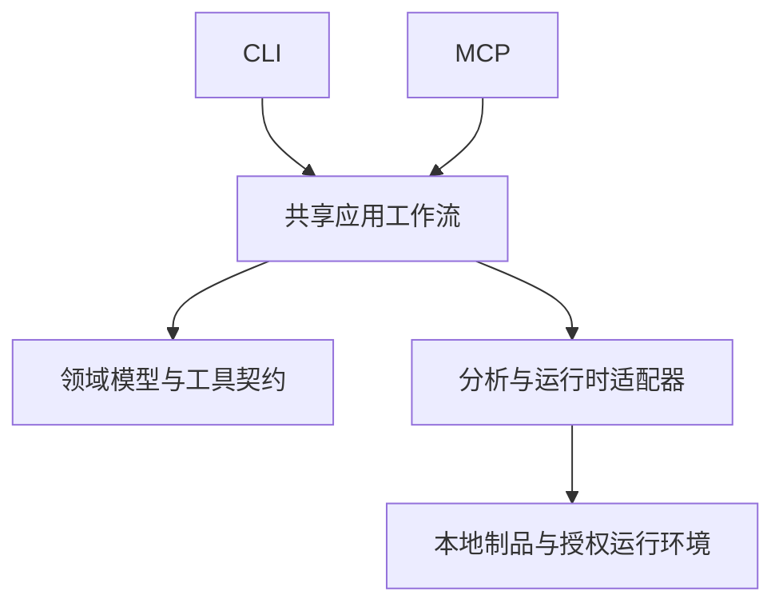

# 架构概览

Tekvro 将同一套分析工作流提供给命令行和 MCP 客户端。输入选择、证据模型与错误语义由共享应用层组织，具体工具的协议和进程管理留在适配层。

## 共享工作流

CLI 与 MCP 调用相同的应用服务，保留相同的目标选择、领域约束、取消与清理语义。两种传输各自负责参数解析和结果交付；机器字段与工具名称是兼容性边界。

分析结果以 Evidence 表达：记录来源、输入身份、观察结果、推断、未知项和覆盖局限。比较与跨层关联消费实际采集的证据，不把未观察到的关系补写成事实。

## 适配器与生命周期

静态文件读取、浏览器观察、应用捕获和外部分析引擎通过独立适配器接入。提供方的通信协议留在各自模块内，不进入领域模型。

受控进程使用共享的身份、超时、取消与清理机制。PID 或可执行路径本身不足以证明进程归属；资源不足或归属不明时，结果保留已采集的事实，并明确报告未完成的部分。

## 代码布局

| 目录                        | 职责                           |
| --------------------------- | ------------------------------ |
| `src/domain/`               | 纯领域类型、语义与证据模型     |
| `src/contracts/`            | 输入输出契约与工具清单         |
| `src/application/`          | 共享分析、比较与证据工作流     |
| `src/cli/`、`src/server/`   | CLI 与 MCP 传输适配            |
| `src/process/`              | 进程身份、监督、取消与资源清理 |
| `src/browser/` 等适配器目录 | 专用格式、运行时与引擎协议     |
| `bridge/`                   | 外部工具侧的桥接实现           |
| `tests/`、`scripts/verify/` | 契约、边界与真实工具链验证     |
| `skill-src/`                | 随发行包提供的 Agent 操作说明  |

## 扩展与验证

新增能力先定义要回答的问题、输入权限和结果契约，再接入共享工作流。可复用的检查与比较优先于绑定单个应用的业务判断。

平台支持由实际工作流验证。包能启动、Schema 合法、受控夹具通过和真实引擎运行分别提供不同范围的证据；单一检查不替代其余验证。

继续阅读：[组件图](https://github.com/ForceMind/Tekvro/blob/main/docs/architecture.mermaid) · [工具契约](../mcp-contracts.md) · [测试指南](../testing.md) · [贡献指南](https://github.com/ForceMind/Tekvro/blob/main/CONTRIBUTING.md)。
